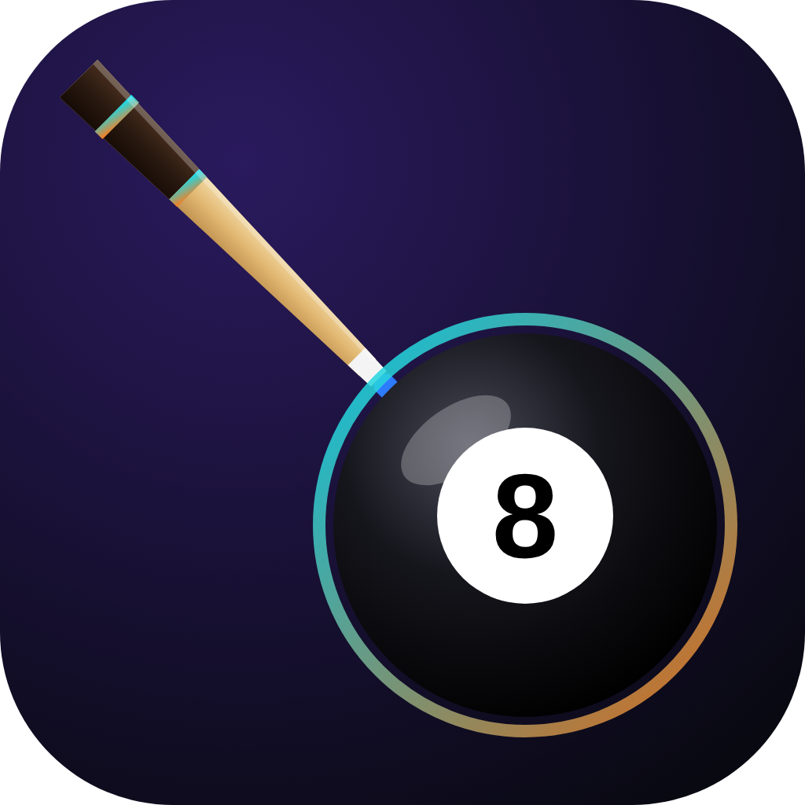

<h1 align="center">Pool Bracket</h1>

A tournament bracket app for **8-ball and 9-ball** pool tournaments. Single or double elimination (upper + lower bracket), best-of-1/3/5/7/9, saved tournaments, and print-friendly brackets.

## Download

| Windows | Mac |
|---|---|
| [**⬇ Download for Windows**](https://github.com/xceed43/Pool-Bracket/releases/latest/download/Pool-Bracket-Setup.exe) | [**⬇ Download for Mac**](https://github.com/xceed43/Pool-Bracket/releases/latest/download/Pool-Bracket.dmg) |

**First time opening it**
- **Windows:** if you see "Windows protected your PC", click **More info → Run anyway**.
- **Mac:** open the `.dmg` and drag Pool Bracket into Applications. Open it once (you'll get a "Not Opened" warning, click **Done**), then go to **System Settings → Privacy & Security**, scroll down to the message about "Pool Bracket", click **Open Anyway**, and enter your password. After that it opens normally.
  - Or, in Terminal: `xattr -cr "/Applications/Pool Bracket.app"` and open it again.

These warnings appear because the app isn't signed with a paid developer certificate. You only see them once.

## Updating

The app shows a banner when a new version is out. Click **Download update**, then install it over the old one. Your saved tournaments stay.

## Using it

1. **+ New tournament**, then enter a name, pick 8-Ball or 9-Ball, the match length and the format.
2. Add players (type a name and press Enter, or paste a list). Shuffle the seeding if you like.
3. **Create bracket**, then enter each match's scores. Winners advance automatically.
4. Tournaments are saved on your computer and show up on the home screen. Use **Export backup** now and then to keep a copy.
